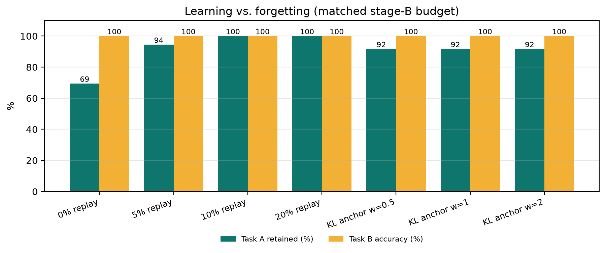

# Replay and KL-anchor baselines: results

**Setup:** Qwen2.5-0.5B-Instruct, LoRA r=8 on q/v projections, run locally on an Apple GPU (MPS). The setting is disjoint, mapping seed 43: Task A gets 8 epochs, then the same adapter continues on Task B for 2 epochs at learning rate 2e-4. Every stage-B run continues the same saved `adapter_A` and gets the same 288 examples and 144 optimizer updates. Evaluation uses 72 fresh-nonce probes in the familiar training templates (36 per task), scored by strict exact match. Produced by `prototype/sequential_replay_sweep.py`.

## Seed 43: replay sweep

| Replay | Replayed / total B ex. | Updates | A after A | A after B | New A failures | A retention | B after A | B after B |
|---:|---:|---:|---:|---:|---:|---:|---:|---:|
| 0% | 0/288 | 144 | 36/36 | 25/36 | 11 | 0.694 | 10/36 | 36/36 |
| 5% | 14/288 | 144 | 36/36 | 34/36 | 2 | 0.944 | 10/36 | 36/36 |
| 10% | 29/288 | 144 | 36/36 | 36/36 | 0 | 1.000 | 10/36 | 36/36 |
| 20% | 58/288 | 144 | 36/36 | 36/36 | 0 | 1.000 | 10/36 | 36/36 |

### Observations

- **Forgetting reproduces, and was stronger this run.** Plain A→B (0% replay) gave 11 new Task A failures, against 5 in the earlier run recorded in `SEQUENTIAL_FAMILIAR_FORGETTING_RESULTS.md`. Task A acquisition (36/36) and Task B acquisition (36/36) both match that run.
- **Every regression collapses to the same code, `R7`.** The 0% failures span cedar, fir and pine (T4), cypress and oak (K2), and spruce (V9). All of them become `R7`, matching the pattern in the earlier run. This is not a frequency effect: Task B's codes are balanced, three items each for K2, R7, T4 and V9. Which mechanism makes stage B bias Task A prompts toward `R7` is open, and is the natural first target for circuit tracing.
- **A small amount of replay removes the measured forgetting at no cost to Task B learning.** 5% replay leaves 2 failures (elm and fir, both again → `R7`). At 10% and 20%, every Task A probe survives. Task B reaches 36/36 at every fraction, so retention is compared at matched B accuracy.

## KL-anchor arm (seed 43, same adapter_A)

| KL weight | Updates | A after A | A after B | New A failures | A retention | B after A | B after B |
|---:|---:|---:|---:|---:|---:|---:|---:|
| 0.5 | 144 | 36/36 | 33/36 | 3 | 0.917 | 10/36 | 36/36 |
| 1 | 144 | 36/36 | 33/36 | 3 | 0.917 | 10/36 | 36/36 |
| 2 | 144 | 36/36 | 33/36 | 3 | 0.917 | 10/36 | 36/36 |

- **The KL anchor cuts forgetting from 11 to 3 failures without any replayed training data.** It uses only the 36 reserved reference prompts and the frozen post-A model's outputs on them. Task B still reaches 36/36.
- **The result does not depend on the weight.** All three weights leave the same 3 failures: cedar, fir and pine, all T4 items, again → `R7`. The logged anchor KL stays small (about 0.001–0.05 nats over the last updates), so the anchors themselves are held in place even at w = 0.5.
- **Interpretation:** pinning outputs on one phrasing (the reference template) does not fully protect the same facts asked in other phrasings (the training-template probes). The forgetting that survives is concentrated on one source label (T4). Replay, which trains on the probes' own grammar, closes the gap; anchoring a single template does not. This points at *which representation* to preserve as the real question, which is exactly what the SAE/activation arms are meant to test.

## Seed 44 replication

_Pending: 0% vs 10% replay on a fresh mapping and initialization._

## Caveats

- One mapping and training seed per condition, and only 36 probes per task. The probes are correlated by item: each item appears 3 times.
- The probes reuse the training grammar with fresh nonces. Held-out paraphrase templates are weaker (see `SEQUENTIAL_FIRST_DEV_RESULTS.md`), so these results speak to retention of a learned lookup, not paraphrase generalization.
- Replay here is unusually favorable. The protected behavior is exactly the replayed task, and old training data is available. In real fine-tuning, a user's protected behaviors often have no training data, which is where activation- or feature-based preservation would need to earn its place.
- The held-out TEST split has not been touched.

## Implication for the project

The cheap baseline is strong. Any SAE- or activation-preservation method now has to match **0 new failures at 10% replay** on this benchmark, or win where replay data isn't available. The KL result shows the gap that remains when only reference prompts exist: 3 failures vs 0. The next comparison should therefore focus on a "no protected training data" condition, where only reference prompts exist, as with the KL anchor, and ask whether activation- or SAE-feature preservation on those same prompts transfers across phrasings better than output-level KL.
